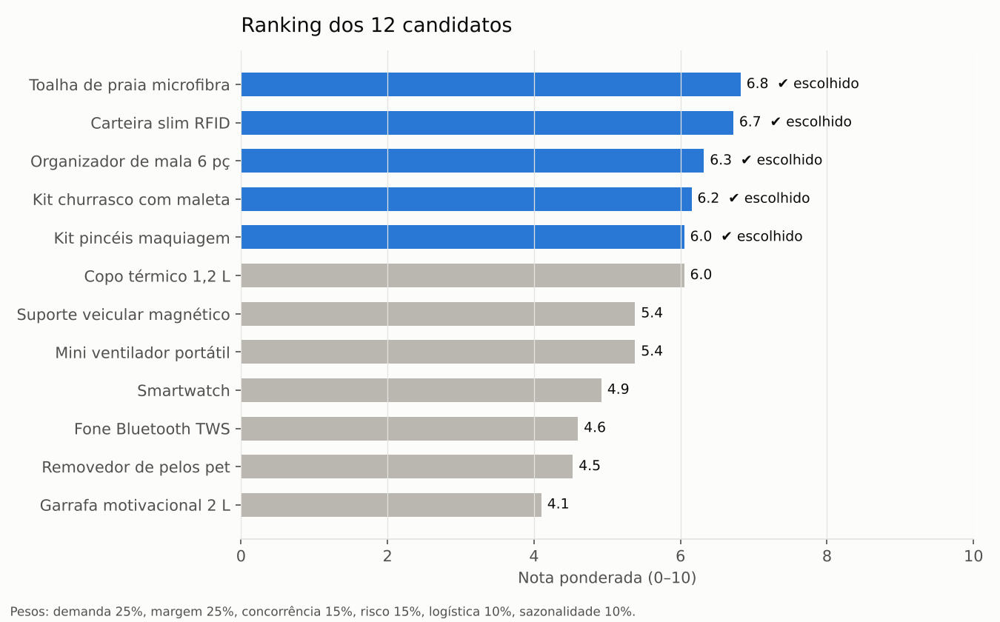
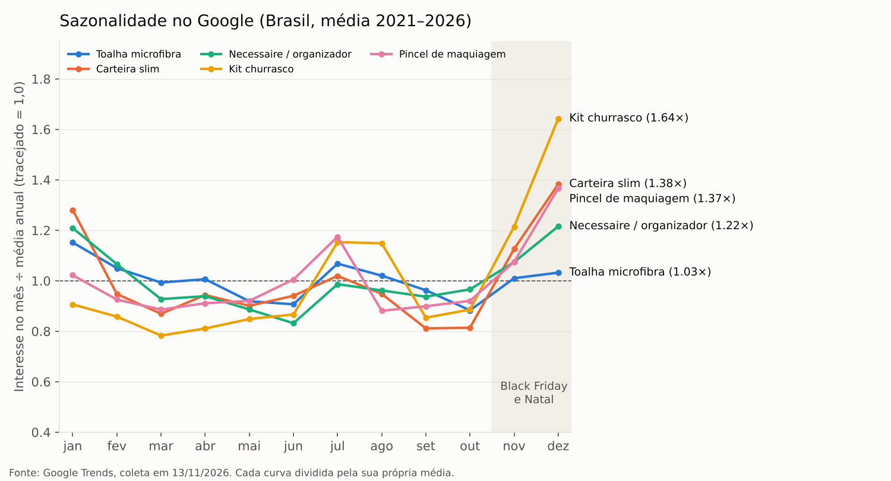
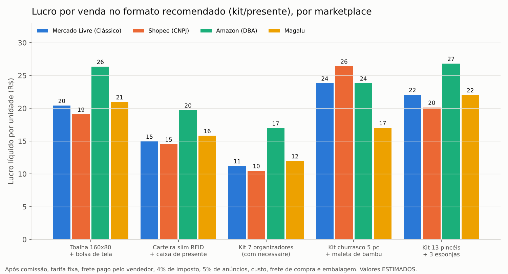

# Pesquisa de Mercado: revenda em marketplaces

**Data da coleta:** 13/11/2026 (sexta-feira). Faltam **14 dias para a Black Friday** (27/11), 17 para a Cyber Monday (30/11) e 42 para o Natal.
**Planilha com todos os números e fórmulas:** `Pesquisa_de_Mercado.xlsx` (nesta pasta; comece pela aba **Escolhidos**).
**Legenda:** os valores marcados como **ESTIMADO** precisam ser confirmados (lista na seção 9).

> **Atualização de 14/11/2026 (Sessão 2):** o conteúdo de cada kit foi ajustado às fotos dos fornecedores encontrados. A toalha vem com bolsa de tela (não estanque) e passou a R$ 59,90. O kit churrasco vem em maleta de bambu, sem avental, e passou a R$ 119,90. O kit de pincéis tem 13 pincéis + 3 esponjas, sem necessaire. A carteira é de alumínio (9,5 × 6 × 0,9 cm). Preços, custos e margens abaixo já estão atualizados e batem com a aba **Escolhidos** da planilha, com os anúncios e com o cronograma.

---

## 1. Resposta curta

Dos 12 candidatos analisados, recomendo começar com **5 produtos**, sempre no **formato kit/presente**. O formato kit eleva o valor do pedido e dilui as tarifas fixas, que corroem a margem de itens abaixo de R$ 80:

| # | Produto (formato de venda) | Preço sugerido | Custo total/un. (ESTIMADO) | Lucro/venda no ML | Margem ML | Por que entra |
|---|---|---|---|---|---|---|
| 1 | **Toalha de praia microfibra 160×80 + bolsa de tela** | R$ 59,90 | R$ 18,96 | R$ 20,41 | 34% | Maior nota no ranking. Busca crescendo (+18% em 12 meses) e verão em Itapema/BC. Leve, não quebra, quase sem devolução |
| 2 | **Carteira slim RFID de alumínio + caixa de presente** | R$ 44,90 | R$ 12,86 | R$ 14,96 | 33% | Presente masculino de Natal (dezembro +38% no Google). Pesa 150 g e tem uma das melhores margens |
| 3 | **Kit 7 organizadores de mala (com necessaire)** | R$ 49,90 | R$ 20,46 | R$ 11,21 | 22% | Férias de dezembro e janeiro. "Necessaire" tem o 3º maior volume de busca medido. Risco quase nulo |
| 4 | **Kit churrasco inox 5 peças com maleta de bambu** | R$ 119,90 | R$ 45,90 | R$ 23,82 | 20% | Maior pico de Natal entre os 12 (dezembro +64%). Maior lucro em reais por venda |
| 5 | **Kit 13 pincéis de maquiagem + 3 esponjas** | R$ 59,90 | R$ 17,90 | R$ 22,07 | 37% | Presente feminino (dezembro +37%). Margem alta no kit. Avulso não compete com a Shopee a R$ 10 |

**Reservas:** mini ventilador portátil (verão forte, mas margem fina e enquadramento no INMETRO a confirmar) e copo térmico 1,2 L (muita demanda, mas só fecha a conta com custo de até R$ 18).

**Descartados:** fone Bluetooth e smartwatch (homologação Anatel obrigatória, fiscalização ativa nos centros de distribuição, devolução alta e marcas grandes dominando), garrafa motivacional (demanda baixa, pico em setembro), suporte veicular e removedor de pelos pet (preço baixo e guerra de preço).

> **Alerta de prazo.** A compra precisa ser de **atacado nacional**: importar não chega a tempo e, como mostra a seção 5, também não compensa em pequena quantidade. O cronograma (02_Cronograma) assume pedido em **16/11**, chegada da toalha (SC) em **18/11** e dos demais (SP) em **24/11**, porque 20/11 é feriado nacional. As publicações ficam em **19/11** (toalha) e **25/11** (demais), a tempo da Black Friday (27/11). Para o Natal, envie ao Full até ~10/12 se ele estiver liberado na sua conta.

---

## 2. Como a pesquisa foi feita (e seus limites)

1. **Lista de candidatos:** 12 produtos escolhidos a partir de rankings de mais vendidos e tendências de 2026 (Shopee 11.11 e Black Friday, Mercado Livre Black Friday 2025, pesquisas Stefanini/Mercado Pago) e de filtros de envio (leve, pequeno, pouco frágil).
2. **Demanda e sazonalidade:** Google Trends Brasil, 5 anos e 12 meses, com todos os termos normalizados na mesma escala (âncora "kit churrasco"). Os arquivos estão em `05_Fontes/google_trends/`.
3. **Anúncios:** **102 anúncios registrados** (aba 3 da planilha), com preço, nota, nº de avaliações, frete grátis, Full e selo "mais vendido" quando visíveis.
4. **Tarifas e impostos:** página oficial da Receita Federal (salva em `05_Fontes/paginas_oficiais/`), tabela oficial do Comsefaz de ICMS sobre importados por estado (PDF salvo) e tabelas 2026 de cada marketplace.
5. **Pontuação:** notas de 0 a 10 com pesos: demanda 25%, margem 25%, concorrência 15%, risco legal/devolução 15%, logística 10% e sazonalidade 10%. A nota de margem é calculada pela própria planilha.

**Limites, sem rodeios:**
- O Mercado Livre e a Shopee bloqueiam a busca automática sem login (verificação de conta/anti-robô), e Amazon e Magalu não estavam acessíveis no ambiente usado. Por isso os anúncios vieram de **resultados indexados de busca** do ML e de **agregadores de ofertas** da Shopee.
- No Mercado Livre, consegui de **5 a 11 anúncios por produto**. Na Shopee, de **0 a 7**. A meta de 10 + 10 **não foi atingida** em todos os produtos. A aba **8_Validar_10_anuncios** traz o formulário pronto, com mínimo, mediana e máximo calculados sozinhos, para você completar em ~10 minutos por produto antes de comprar.
- "Vendidos" quase nunca aparece nesses resultados. Usei o **nº de avaliações** como sinal de volume (no ML, em geral, só uma parte dos compradores avalia).
- As tarifas de ML, Shopee, Amazon e Magalu vieram de fontes secundárias recentes que citam as tabelas oficiais. As páginas de ajuda dos marketplaces também bloquearam o acesso automático. **Confirme no painel de vendedor** (é rápido e gratuito).

---

## 3. Demanda e sazonalidade (Google Trends)

| Termo | Volume médio (escala comum) | Fator nov | Fator dez | Pico | Últimos 12 meses x 12 anteriores |
|---|---|---|---|---|---|
| smartwatch | 434 | 1,11 | 1,29 | dez | -4% |
| fone bluetooth | 352 | 1,02 | 1,11 | dez | -11% |
| necessaire | 133 | 1,07 | 1,22 | dez | 0% |
| copo térmico | 56 | 1,10 | 1,47 | dez | +7% |
| kit churrasco | 38 | 1,21 | **1,64** | dez | +3% |
| pincel de maquiagem | 17 | 1,07 | 1,37 | dez | +1% |
| porta cartão | 16 | 1,00 | 1,15 | dez | -4% |
| mini ventilador | 14 | 1,34 | 1,42 | jan | +9% |
| suporte celular carro | 12 | 0,94 | 1,05 | ago | +13% |
| toalha microfibra | 6 | 1,01 | 1,03 | jan | **+18%** |
| carteira slim | 4,5 | 1,13 | 1,38 | dez | -2% |
| removedor de pelos | 4,3 | 0,98 | 0,89 | jan | -6% |
| organizador de mala | 4,2 | 0,95 | 1,35 | dez | -32% |
| garrafa motivacional | 1,6 | 0,56 | 0,55 | ago | 0% |

Leitura:
- **Natal manda.** Kit churrasco, copo térmico, carteira e pincéis têm pico em **dezembro**, e não em novembro. A Black Friday conta, mas o grosso das vendas desses itens vem entre 1º e 20 de dezembro, junto com a 2ª parcela do 13º (até 20/12).
- **Verão manda no litoral.** Mini ventilador e toalha têm pico em **janeiro**. A busca de toalha é nacional e plana. A vantagem em Itapema/BC é a demanda local (praia), que não aparece no Google Brasil.
- "Organizador de mala" caiu como termo (-32%), mas o público migrou para "necessaire" e "kit organizador", que seguem estáveis. Os anúncios líderes têm mais de 1.100 avaliações.

---

## 4. Preços praticados (amostra de anúncios ativos)

| Produto | ML: nº / mín / mediana / máx | Shopee: nº / mín / mediana / máx | Maior nº de avaliações | O que se vê |
|---|---|---|---|---|
| Copo térmico 1,2 L | 11 / 39,52 / 50,67 / 147,63 | 1 / 39,98 | 1.247 | Muitos genéricos entre R$ 40 e R$ 60; "desconto" inflado é comum |
| Garrafa motivacional | 6 / 24,99 / 36,30 / 138,32 | 3 / 11,99 / 32,99 / 39,99 | 195 | Kit de 3 é o mais vendido |
| Mini ventilador | 7 / 20,99 / 33,57 / 99,50 | 2 / 18,99 | 1.492 | Líder a R$ 33,57 com selo "mais vendido" |
| Kit pincéis | 8 / 18,40 / 45,34 / 68,70 | 5 / 8,50 / 12,99 / 89,90 | 808 | Macrilan domina o ML. Na Shopee, kits de 20 por R$ 11–13 |
| Carteira slim RFID | 6 / 21,39 / 51,99 / 115 | (sem dados) | 2.235 | Muito volume a R$ 21–25; alumínio "premium" a R$ 79 |
| Kit churrasco c/ maleta | 9 / 51,40 / 107,99 / 189,59 | 3 / 53,99 / 68,99 / 78,99 | 116 | Faixa forte entre R$ 95 e R$ 110; Tramontina como referência |
| Toalha microfibra | 6 / 35,20 / 52,99 / 76,90 | (sem dados) | 473 | Nabaiji (Decathlon) domina; poucos concorrentes com volume |
| Removedor de pelos | 6 / 17,60 / 26,00 / 122,78 | (sem dados) | 1.466 | R$ 18–29 |
| Suporte veicular | 6 / 12,89 / 27,50 / 62,00 | (sem dados) | 847 | R$ 13–40 |
| Organizador de mala | 5 / 20,39 / 24,43 / 59,18 | 7 / 15,99 / 24,95 / 57,82 | 1.255 | Líderes a R$ 20–25 com mais de 1.000 avaliações |
| Fone TWS | 5 / 19,60 / 43,52 / 55,23 | (sem dados) | 4.341 | Líder a R$ 19,60; muitas queixas de bateria |
| Smartwatch | 4 / 198,85 / 263,70 / 308,99 | (sem dados) | 15.788 | Samsung e Xiaomi no topo |

**Reputação, frete e Full:** os anúncios com selo "mais vendido" e mais de 1.000 avaliações são de vendedores com reputação alta (verde/MercadoLíder). Frete grátis aparece na maioria dos anúncios acima de R$ 79 (é obrigatório no ML nessa faixa). O Full é comum nos líderes. Como conta nova, você começa sem reputação, e por isso o formato kit (diferente dos líderes) é a forma de não brigar de frente por preço.

---

## 5. Onde comprar e custo total por unidade

**Recomendação: atacado nacional** (com nota fiscal), pelos motivos abaixo.

| Produto | Custo atacado (ESTIMADO) | Importado via CNPJ c/ impostos* | Mais barato |
|---|---|---|---|
| Toalha microfibra | R$ 15,00 | R$ 57,01 | Nacional |
| Carteira slim | R$ 8,00 | R$ 24,74 | Nacional |
| Organizador de mala | R$ 12,00 | R$ 65,62 | Nacional |
| Kit churrasco | R$ 38,00 | R$ 187,17 | Nacional |
| Kit pincéis | R$ 12,00 | R$ 40,88 | Nacional |

\* FOB Alibaba (ESTIMADO) + frete expresso de US$ 8/kg, com dólar a R$ 5,58. Sobre isso incidem **Imposto de Importação de 60%** e **ICMS-SC de 17% "por dentro"**, o que dá um multiplicador de ~1,93×.

**Regras vigentes de importação (fontes oficiais):**
- **Receita Federal** (página "Quanto vou pagar de imposto?", atualizada em 14/09/2026): em sites certificados no **Remessa Conforme**, compras de **até US$ 50 têm II de 0%** (MP 1.357/2026, convertida em lei). Acima de US$ 50, o II é de 60% menos US$ 30 de desconto. Em sites não certificados, 60% sobre tudo. O ICMS é calculado "por dentro": base = (produto + frete + seguro + II) ÷ (1 − alíquota).
- **ICMS de SC sobre importações simplificadas: 17%** (tabela oficial do Comsefaz, Convênio ICMS 81/2023; SC não aderiu aos 20%).
- **Atenção:** a isenção até US$ 50 vale para **pessoa física, para consumo próprio**. Comprar no AliExpress/Shopee internacional como pessoa física **para revender** é irregular: não há nota de entrada, e a habitualidade pode levar à apreensão da mercadoria (pena de perdimento). **Não recomendo.**
- Importação formal (DI, carga consolidada, com II pela TEC do NCM + IPI + PIS/COFINS + ICMS + despachante) só compensa com pedidos maiores. Itajaí tem porto e muitas tradings, e vale cotar numa 2ª fase, quando os produtos estiverem validados.

**Composição do custo total por unidade** (aba 4 da planilha): custo do produto + 6% de frete do fornecedor até você + embalagem (R$ 1,20 a R$ 3,50 por peso) + imposto sobre a venda (4%, Simples Nacional) + 5% de verba de anúncios + comissão + tarifa fixa + frete pago pelo vendedor.

**Onde procurar fornecedor (para a sessão 2 / sua cotação):**
- **Toalha, organizador, necessaire:** polo têxtil de Brusque/Blumenau (perto de você) e atacadistas do Brás (SP).
- **Carteira, pincéis, organizador:** atacadistas da 25 de Março (SP), que despacham para SC, e importadoras com CNPJ que vendem no "Atacado" do ML e da Shopee.
- **Kit churrasco:** distribuidores de utilidades domésticas (ex.: linhas Bel, Fixxar), Tenda Atacado e importadoras de Itajaí/Navegantes.
- Peça sempre **nota fiscal**, **amostra** e preço por faixa de quantidade (10/50/100).

---

## 6. Tarifas atuais dos marketplaces (premissas da planilha, editáveis na aba 5)

| Marketplace | Comissão | Tarifa fixa | Frete | Observações |
|---|---|---|---|---|
| **Mercado Livre** | Clássico 10–14% / Premium 15–19%, por categoria | Abaixo de R$ 79: custo por unidade de R$ 5,65 a R$ 8,75 conforme peso (desde 02/03/2026); usei R$ 6,75 (ESTIMADO) | Acima de R$ 79, o frete grátis é obrigatório e pago em boa parte pelo vendedor (usei R$ 20–25, ESTIMADO, com desconto de reputação) | Full cobra armazenagem por dia, conforme o tamanho |
| **Shopee (CNPJ)** | 20% até R$ 79,99; 14% acima | R$ 4,50 até R$ 79,99 (era R$ 4,00 até 30/09/2026); R$ 16 (R$ 80–99,99), R$ 20 (R$ 100–199,99), R$ 26 (≥ R$ 200) | Programa de frete grátis incluso, sem adicional (desde 03/2026) | Vendedor CPF: relatos de +R$ 3 por item acima de 450 pedidos em 90 dias |
| **Amazon (DBA)** | 10–15% por categoria (casa 12%, beleza 13%, moda 14%) | Plano Individual R$ 2/item ou Profissional R$ 19/mês | Acima de R$ 79, frete pago pelo vendedor (ESTIMADO R$ 18–23) | Profissional vale a partir de ~10 vendas/mês |
| **Magalu** | 10–20% por categoria (usei 16%) | R$ 5,00/item (R$ 5,50 em moda/beleza/pet desde 10/09/2026) | Coparticipação acima de R$ 79 (ESTIMADO) | Promoção de 9,9% para novos sellers |

**Imposto sobre a venda:** como **MEI** (teto de R$ 81 mil/ano somando todos os canais), você paga só o DAS fixo de **R$ 82,05/mês** (comércio, 2026). A planilha usa **4% (Simples, ME)** para ficar conservadora: se você for MEI, o lucro real por venda é maior. MEI precisa de inscrição estadual em SC para emitir NF-e de produto.

**Leituras importantes da conta:**
- **Abaixo de R$ 80, a Shopee fica cara** (20% + R$ 4,50). Na carteira avulsa a R$ 27,90, sobram R$ 5,63. No organizador avulso, R$ 2,01. Daí a regra do **kit**.
- **Acima de R$ 79 no ML, o frete pesa:** o kit de 2 copos térmicos (1,3 kg) dá **prejuízo** no ML, e por isso o copo saiu da lista.
- A Amazon aparece com o melhor lucro porque, abaixo de R$ 79, o frete é do comprador. Em compensação, o tráfego para vendedor novo é menor. Use a Amazon como **canal complementar**.

---

## 7. Exigências legais e regras dos marketplaces

| Produto | Certificação | Outras regras | Risco |
|---|---|---|---|
| Toalha microfibra | Não exige INMETRO | **Etiqueta têxtil obrigatória** (composição, CNPJ, origem, cuidados — Resolução Conmetro 02/2008) | Baixo |
| Carteira slim RFID | Não exige | Não usar marcas de terceiros (Secrid, Ridge…). A promessa de "bloqueio RFID" precisa ser verdadeira (CDC) | Baixo |
| Organizador de mala | Não exige | Etiqueta de composição/origem | Baixo |
| Kit churrasco | Não exige | Facas de cozinha podem ser vendidas (confira as regras da categoria; indique "recomendado para maiores de 18 anos"). Inox de grau alimentício. Não citar "Tramontina" se não for a marca. Protetor de lâmina no envio | Baixo–médio |
| Kit pincéis | Não exige Anvisa (pincel não é cosmético) | Se incluir esponja/necessaire, tudo bem. **Não** incluir cosméticos sem registro | Baixo |
| Copo térmico (reserva) | Não exige | Material em contato com alimento (inox 304, tampa sem BPA). **Nunca** usar "Stanley" ou "tipo Stanley" | Médio |
| Mini ventilador (reserva) | **A confirmar.** As portarias do INMETRO para ventiladores tratam de aparelhos de tomada; o enquadramento de modelos a bateria/USB não foi confirmado | Bateria de lítio (restrição no transporte aéreo) | Médio |
| Fone TWS / Smartwatch (descartados) | **Homologação Anatel obrigatória** | A Anatel lacrou estoques irregulares em CDs do ML e exige o código no anúncio; marketplaces respondem solidariamente | **Alto** |

**Registro de marca (INPI):** não é obrigatório para vender. Recomendo registrar uma **marca própria** (classe 21 para utensílios/copos, 18 para carteiras/bolsas, 24 para toalhas) quando o volume justificar. Com a marca, você entra no "Brand Registry" da Amazon e no Programa de Proteção de Marca do ML, o que impede outros de pegarem carona no seu anúncio. Valor-base do INPI para ME/MEI: confirmar no site (tem desconto).

---

## 8. Logística e devoluções

| Produto | Peso c/ embalagem | Caixa (cm) | Fragilidade | Risco de devolução | Cuidado |
|---|---|---|---|---|---|
| Toalha + bolsa de tela | 0,40 kg | 25×18×6 | Nenhuma | Baixo | Informar medidas reais em cm |
| Carteira + caixa | 0,15 kg | 14×10×3 | Nenhuma | Baixo | Dizer que cabem até 5 cartões e a CNH-cartão |
| Kit 7 organizadores | 0,55 kg | 30×22×5 | Nenhuma | Baixo | Testar zíper das amostras |
| Kit churrasco + maleta de bambu | 1,60 kg | 46×21×10 | Baixa | Baixo–médio | Fechos da maleta; protetor de lâmina |
| Kit pincéis + 3 esponjas | 0,35 kg | 22×12×6 | Baixa | Baixo | Fotos reais (cor/tamanho) |

Todos cabem em envelope/caixa pequena e podem ir para o **Full** (limite de 20 kg / 80 cm por lado).

---

## 9. Notas finais e pendências

| Produto | Demanda | Margem* | Concorrência | Risco | Logística | Sazonalidade | **Nota** |
|---|---|---|---|---|---|---|---|
| Toalha microfibra | 4 | 7,1 | 6 | 9 | 9 | 9 | **6,8** |
| Carteira slim RFID | 4 | 8,3 | 5 | 8 | 10 | 7 | **6,7** |
| Organizador de mala | 6 | 3,7 | 5 | 9 | 10 | 8 | **6,3** |
| Kit churrasco | 7 | 3,4 | 6 | 7 | 6 | 10 | **6,2** |
| Kit pincéis | 5 | 6,2 | 3 | 8 | 9 | 7 | **6,0** |
| Copo térmico | 9 | 3,0 | 4 | 7 | 6 | 8 | 6,0 |
| Suporte veicular | 5 | 5,3 | 3 | 7 | 9 | 4 | 5,4 |
| Mini ventilador | 6 | 2,3 | 5 | 5 | 8 | 10 | 5,4 |
| Smartwatch | 10 | 1,9 | 2 | 1 | 8 | 7 | 4,9 |
| Fone TWS | 10 | 0,2 | 2 | 1 | 9 | 7 | 4,6 |
| Removedor de pelos | 3 | 2,5 | 4 | 9 | 9 | 3 | 4,5 |
| Garrafa motivacional | 3 | 2,8 | 4 | 7 | 7 | 3 | 4,1 |

\* A nota de margem considera o produto **avulso** (média de ML e Shopee). No formato kit, as margens de organizador e churrasco sobem para 20–22% no ML (aba 4b). Copo térmico e pincéis empataram (6,0). Os pincéis ficaram com a vaga porque o kit dá 37% de margem no ML, contra prejuízo no kit de 2 copos.

### O que você precisa confirmar (também na aba 9 da planilha)
1. **Custo real de atacado** dos 5 produtos (3 cotações cada, com NF e amostra). É o número que mais mexe na margem.
2. **Tarifas e frete** no seu painel de vendedor de cada marketplace, com peso e medidas reais.
3. **Enquadramento:** MEI (CNAE de comércio varejista + inscrição estadual em SC) ou ME no Simples. Pergunte ao contador sobre ICMS-ST/antecipação em compras de outro estado.
4. **Etiquetas têxteis** (toalha, organizador, necessaire) e **inox** (kit churrasco).
5. **Validar 10 anúncios no ML e 10 na Shopee** de cada escolhido (aba 8).
6. **Prazo do fornecedor:** a Black Friday exige estoque até ~22/11; para o Natal, envio ao Full até ~10/12.

---

## Fontes
Todas consultadas em 13/11/2026 (pesquisa) e 14/11/2026 (Sessão 2: fotos, horários e campanhas — ver 02_Cronograma, aba Premissas_e_Fontes, e 05_Fontes\Creditos_Imagens.txt).

- Receita Federal — "Quanto vou pagar de imposto?" (Remessa Conforme), atualizada em 14/09/2026: https://www.gov.br/receitafederal/pt-br/assuntos/aduana-e-comercio-exterior/manuais/remessas-postal-e-expressa/preciso-pagar-impostos-nas-compras-internacionais/quanto-pagarei-de-imposto (cópia em `05_Fontes/paginas_oficiais/rf_remessa_conforme.txt`)
- Comsefaz — Alíquota de ICMS sobre importações pelo RTS por UF (Convênio ICMS 81/2023): https://comsefaz.org.br/novo/wp-content/uploads/2025/05/Aliquota-ICMS-import.-RTS-por-UF-17-e-20-CV81-23-v21-05-2025.pdf (cópia em `05_Fontes/paginas_oficiais/`)
- MP 1.357/2026 (II zero até US$ 50) — InfoMoney: https://www.infomoney.com.br/economia/dou-extra-traz-mp-que-isenta-tributacao-para-compras-internacionais-ate-us-50/ ; aprovação no Senado — O Povo: https://mais.opovo.com.br/jornal/economia/2026/09/04/senado-aprova-mp-que-acaba-com-taxa-das-blusinhas-texto-vai-a-sancao-presidencial.html
- Tarifas Mercado Livre 2026 — Vendedorix: https://vendedorix.com.br/blog/mercado-livre-tarifas-2026-tabela-completa ; Rally de Vendas: https://www.rallydevendas.com.br/blog/taxas-do-mercado-livre-quanto-custa-vender ; Socalculadora: https://socalculadora.com.br/blog/taxas-mercado-livre-2026
- Tarifas Shopee 2026 — E-Commerce Brasil: https://www.ecommercebrasil.com.br/artigos/shopee-acaba-com-o-teto-de-comissao-de-r-100-e-aumenta-a-taxa-fixa-cobrada-por-cada-item-vendido-em-ate-550 ; Nação Digital: https://nacao.digital/blog/taxas-da-shopee/ ; Multdrop: https://multdrop.com.br/taxas-da-shopee/
- Tarifas Amazon 2026 — YAV: https://yav.com.br/blog/quanto-custa-vender-amazon-2026/ ; GoSmarter: https://gosmarter.com.br/taxas-amazon-brasil-2026/
- Tarifas Magalu 2026 — Cowimi: https://cowimi.com.br/blog/taxas-do-magalu ; Precifica Canal: https://www.precificacanal.com.br/taxas/magalu/
- MEI 2026 (teto e DAS) — O Povo: https://www.opovo.com.br/noticias/economia/2026/01/05/mei-vai-pagar-mais-em-2026-contribuicao-mensal-sobe-para-rs-8105.html ; Contmatic: https://simplifique.contmatic.com.br/blogs/mei-2026-limite-faturamento-o-que-muda
- Anatel x marketplaces — Teletime: https://teletime.com.br/23/06/2026/anatel-e-marketplaces-minicelulares/ ; Teletime: https://teletime.com.br/25/09/2026/anatel-e-mercado-livre-voltam-a-discutir-atuacao-da-agencia-sobre-marketplaces/
- Tendências Black Friday 2026 — Exame: https://exame.com/marketing/o-que-os-brasileiros-querem-comprar-na-black-friday-2026/ ; Mercado & Consumo (Shopee 11.11): https://mercadoeconsumo.com.br/11/11/2026/ecommerce/shopee-registra-alta-de-90-nas-vendas-na-semana-que-antecede-o-11-11/
- Câmbio — Brasil61 (09/11/2026): https://brasil61.com/n/dolar-hoje-fecha-em-leve-alta-a-r-5-51-apos-oscilar-entre-queda-e-valorizacao-bras2617447
- Preços de referência no Alibaba (copos 40 oz): https://www.alibaba.com/price-comparison/1.2-l-tumbler-with-handle
- Anúncios: as buscas do Mercado Livre usadas estão na aba 2 da planilha (coluna "Busca no ML"). Agregadores Shopee: melhoraopreco.com.br, fazaboa.com.br, descontonopreco.com.br, escorregaopreco.com.br.
- Google Trends: https://trends.google.com (dados brutos em `05_Fontes/google_trends/`).
